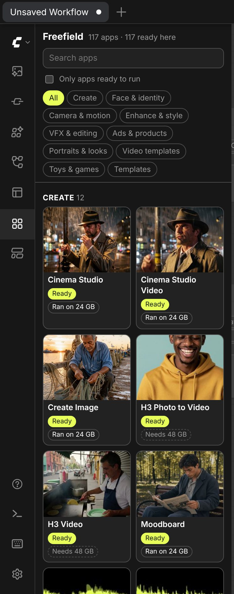
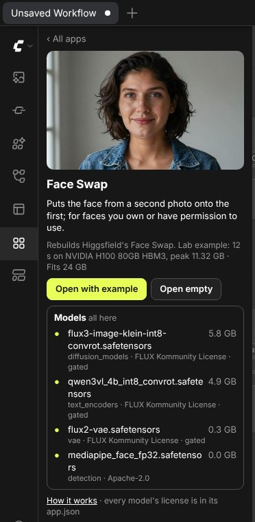

# ComfyUI-freefield

[Freefield](https://github.com/neuregex/freefield)'s 117 image, video, VFX and audio apps inside ComfyUI. A sidebar
tab lists them by category; pick one, download its open-weight models with one button, and open it as a workflow
with the lab's example already filled in. Then press Run.

<p>


</p>

There are no new nodes. Every Freefield app is a plain ComfyUI workflow, so what you open is ordinary ComfyUI that
you can edit, save and share. The full Freefield studio (web UI, history, lab) lives in the
[main repo](https://github.com/neuregex/freefield); this node is the shortest way to try its apps in a ComfyUI you
already have.

## Install

```sh
cd ComfyUI/custom_nodes
git clone https://github.com/neuregex/ComfyUI-freefield
```

(On ComfyUI Desktop the folder is `custom_nodes` inside the ComfyUI folder you chose at install.) A listing in the
Comfy Registry, so ComfyUI Manager can install it by name, is on its way.

Restart ComfyUI and open the **Freefield** tab in the left sidebar (the grid icon).

## Use

1. Find an app by category or search. Each card says whether it is **Ready** here or how much it still needs to
   download, and how it does on a 24 GB card: **Ran on 24 GB** for the apps tested on one (see [Tested](#tested)),
   otherwise Freefield's estimate from the models' weight sizes.
2. On the app's page, **Download** fetches the model files the workflow loads from Hugging Face into ComfyUI's model
   folders, under their current names (`diffusion_models`, `text_encoders`, not the old `unet` and `clip`). Files
   arrive as `.part` and are renamed when complete, so an interrupted download resumes. Effects, Styles and Talking
   also list LoRAs the workflow does not load as it opens (the other effects and styles, a LoRA to add yourself);
   those have a button of their own.
3. **Open with example** loads the app in a new workflow tab with the values and input files of the example Freefield's
   lab made on a GPU. **Open empty** loads the app's defaults. Press **Run**.

Gated models (FLUX 3 Klein, LTX-2.5) need their license accepted on huggingface.co and a token: run
`hf auth login`, or set `HF_TOKEN`, before starting ComfyUI.

## What it needs

- **ComfyUI 0.42 or newer.** The apps use core nodes from that version; the tab lists any node type your ComfyUI lacks.
- **Two custom node packs for some apps.** ComfyUI-LTXVideo (the LTX-2.5 IC-LoRA apps) and ComfyUI-CrossViewWarp
  (Re-shoot); the app's page names them and links them. ComfyUI Manager installs both.
- **Disk and VRAM.** The app page lists every file with its size and license. Freefield's VRAM label adds up the
  weight sizes; it is an estimate, not a measurement. ComfyUI can keep part of the weights in system RAM, so an app
  labeled above 24 GB can still run on a 24 GB card with enough RAM: Dub and Cinema Studio Video did (see below).

## Tested

On 5 November 2026, 72 of the 117 apps ran with their catalog example on a Windows PC with an RTX 3090 Ti (24 GB) and
104 GB of RAM, under ComfyUI 0.42.0 with dynamic VRAM and PyTorch 2.11 + CUDA 13.0, all without an error. Among them
are Dub (135 s) and Cinema Studio Video (144 s), whose weights add up to more than 24 GB and which Freefield's estimate
lists as needing 48 GB. [`tested/rtx3090ti-windows-2026-11-05.json`](tested/rtx3090ti-windows-2026-11-05.json) has
every app with its time, and the tab shows them. The other 45 apps have not run on a 24 GB card yet, among them the
four MiniMax H3 apps (H3 Photo to Video, H3 Video, Extend Video, Re-shoot), whose text encoder alone is 27 GB.

## How it works

- `catalog/` is a snapshot of the main repo: every ready app's `app.json` and `workflow.api.json`, unchanged, plus
  `catalog.json` (categories, models, VRAM, the lab's example) and a thumbnail per app. `tools/sync_catalog.py`
  writes it from a checkout of the main repo. `tested/` lists the apps that ran on a 24 GB card through this node.
- **Download** gets every file the app's workflow loads as the tab opens it, empty or with the example. That includes
  files Freefield marks optional, such as the small Gemma model of the video apps' prompt enhancer: ComfyUI checks every
  loader before it runs anything, even one on a branch that is switched off. A new file goes to the first folder
  ComfyUI uses for its kind (an `extra_model_paths.yaml` folder with `is_default: true` comes first).
- Opening an example downloads its input files once from the main repo, at the `ref` that `catalog.json` names, into
  ComfyUI's input folder, as `freefield_<app>_<input>.<ext>`, and fills the workflow exactly as Freefield's lab does.
- The node reaches the network only when you press a button: huggingface.co for models, raw.githubusercontent.com
  for example files.

## Tests

```sh
FREEFIELD_SRC=../freefield python -m pytest tests
```

Checks the catalog and that every example opens as exactly the prompt Freefield's lab ran for it (117 apps).
`tests/e2e/` drives a real ComfyUI with Playwright: the tab, search, opening Face Swap with its example (18 nodes,
both photos in their loaders), a model-free app run through the queue, and a download from a stand-in for Hugging
Face (Smooth's model, then Styles: the files its workflow loads, and the other styles' LoRAs with the second button).
Both pass on a CPU-only ComfyUI 0.42.0 with frontend 1.55.18 on Linux. On a GPU see [Tested](#tested); it has not been
tried on a Mac.

## License

MIT. Model weights are not part of this repository and keep their own licenses, listed per model on each app's
page. Freefield is an independent open-source project. It is not affiliated with, endorsed by or sponsored by
Higgsfield.
